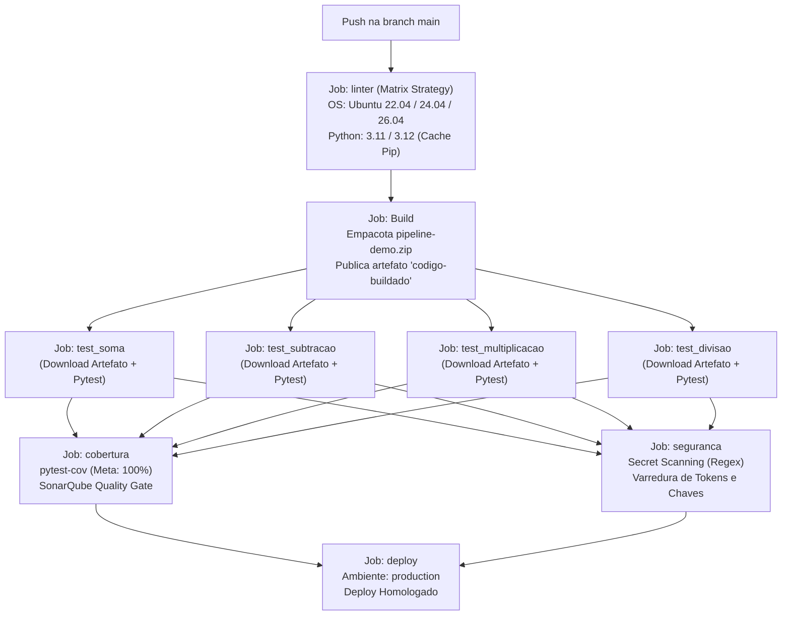

<h1 align="center">
  🧮 Calculadora Modular em Python + CI/CD & Docker
</h1>

<p align="center">
  
  
  
  
  
  
  
</p>

<p align="center">
  Projeto prático demonstrando uma esteira completa de <strong>Integração Contínua (CI)</strong> e <strong>Entrega Contínua (CD)</strong>, contemplando análise estática de código (linter), geração de artefatos de build, suíte de testes unitários modulares e paralelos, cobertura de código com Quality Gate (SonarQube/SonarCloud), varredura automatizada de segurança de credenciais, empacotamento em contêiner Docker e estágio de deploy para produção.
</p>

<hr>

## 📑 Índice

- [Sobre o Projeto](#-sobre-o-projeto)
- [Estrutura do Repositório](#-estrutura-do-repositório)
- [Arquitetura da Pipeline CI/CD](#-arquitetura-da-pipeline-cicd)
  - [Fluxo de Execução da Pipeline](#fluxo-de-execução-da-pipeline)
  - [Detalhamento dos Estágios](#detalhamento-dos-estágios)
- [Containerização com Docker](#-containerização-com-docker)
- [Gerenciamento de Dependências (Dependabot)](#-gerenciamento-de-dependências-dependabot)
- [Pré-requisitos](#-pré-requisitos)
- [Como Executar Localmente](#-como-executar-localmente)
  - [1. Clonar o repositório](#1-clonar-o-repositório)
  - [2. Instalar dependências](#2-instalar-dependências)
  - [3. Executar o Linter (Flake8)](#3-executar-o-linter-flake8)
  - [4. Executar os Testes Unitários](#4-executar-os-testes-unitários)
  - [5. Executar Análise de Cobertura de Código](#5-executar-análise-de-cobertura-de-código)
  - [6. Executar via Docker](#6-executar-via-docker)

---

## 💻 Sobre o Projeto

A aplicação consiste em uma calculadora desenvolvida em **Python**, com funções matemáticas modulares e independentes:
- **Operações básicas:** Soma, Subtração, Multiplicação e Divisão (com tratamento para divisão por zero).
- **Cálculo composto:** Função utilitária para cálculo de total.

O objetivo central deste repositório é servir como referência sólida de **boas práticas em Engenharia de Software e DevOps**, implementando automação robusta via **GitHub Actions**, garantindo integridade de código, qualidade contínua, governança e segurança antes de qualquer liberação para ambiente produtivo.

---

## 📁 Estrutura do Repositório

```text
.
├── .github/
│   ├── dependabot.yml             # Configuração para checagem semanal e atualização de dependências
│   └── workflows/
│       └── testes.yml             # Pipeline completa CI/CD no GitHub Actions
├── calculadora.py                 # Módulo principal com as operações matemáticas
├── dockerfile                     # Imagem Docker para execução containerizada da aplicação
├── requirements.txt               # Especificação de dependências e versões do projeto
├── sonar-project.properties       # Configuração de escopo, exclusões e métricas do SonarQube
├── test_soma.py                   # Teste unitário para a operação de soma
├── test_subtracao.py              # Teste unitário para a operação de subtração
├── test_multiplicacao.py          # Teste unitário para a operação de multiplicação
├── test_divisao.py                # Teste unitário para a operação de divisão
├── test_calcular_total.py         # Teste unitário para a função de cálculo total
└── README.md                      # Documentação técnica do projeto
```

---

## ⚙️ Arquitetura da Pipeline CI/CD

A esteira de automação é disparada a cada `push` realizado na branch `main`. Ela implementa um fluxo estruturado com controle de dependências entre jobs (`needs`), garantindo que estágios subsequentes só ocorram mediante a aprovação irrestrita das etapas anteriores.

### Fluxo de Execução da Pipeline



### Detalhamento dos Estágios

1. **Análise de Estilo e Código (`linter`):**
   - **Matrix Strategy:** Validação cruzada em 3 versões do Ubuntu (`ubuntu-22.04`, `ubuntu-24.04`, `ubuntu-26.04`) e 2 versões do Python (`3.11` e `3.12`).
   - **Cache de Dependências:** Otimização via cache de pacotes `pip` para acelerar o tempo de execução do workflow.
   - **Flake8:** Checagem rigorosa de aderência ao padrão PEP 8.

2. **Geração e Publicação de Artefato (`Build`):**
   - Depende do sucesso do `linter`.
   - Empacota o código-fonte em um arquivo compactado `pipeline-demo.zip`.
   - Publica o artefato versionado como `codigo-buildado` utilizando `actions/upload-artifact@v4`.

3. **Suíte de Testes Unitários Paralelos (`test_*`):**
   - Os jobs `test_soma`, `test_subtracao`, `test_multiplicacao` e `test_divisao` são executados em paralelo.
   - Consomem o artefato seguro publicado na etapa de build (`actions/download-artifact@v4`).
   - Testam cada operação de maneira isolada com `pytest`.

4. **Cobertura de Código e Quality Gate (`cobertura`):**
   - Executa `pytest --cov=calculadora --cov-report=xml --cov-fail-under=100`.
   - **Meta de 100%:** A pipeline falha caso qualquer linha ou ramificação do código fique desprovida de teste.
   - **SonarQube / SonarCloud:** Integração via `SonarSource/sonarqube-scan-action@v7` para análise profunda de qualidade, vulnerabilidades, *bugs* e *code smells*, utilizando as diretrizes de `sonar-project.properties`.

5. **Varredura de Segurança e Segredos (`seguranca`):**
   - Scanner estático automatizado que inspeciona o código em busca de possíveis credenciais expostas inadvertidamente (como tokens do GitHub `ghp_`, credenciais AWS `AKIA` e chaves genéricas de API).
   - Impede o avanço para homologação/produção caso um segredo seja encontrado.

6. **Entrega Contínua (`deploy`):**
   - Depende do sucesso simultâneo dos jobs de `cobertura` e `seguranca`.
   - Aponta para o ambiente formal de `production`, concluindo a esteira com o processo de implantação.

---

## 🐳 Containerização com Docker

O projeto inclui um `dockerfile` otimizado baseado na imagem `python:3.12-slim`, garantindo um ambiente de execução leve, padronizado e isolado.

### Como gerar a imagem e rodar o contêiner:

```bash
# Construir a imagem Docker
docker build -t pipeline-calculadora .

# Executar o contêiner interativo
docker run -it --rm pipeline-calculadora
```

---

## 🤖 Gerenciamento de Dependências (Dependabot)

O repositório possui o GitHub Dependabot ativo (`.github/dependabot.yml`) configurado para o ecossistema `pip`, com rotina de checagem semanal. Sempre que houver novas versões estáveis ou correções de vulnerabilidade nas bibliotecas (`flake8`, `pytest`, `pytest-cov`, `requests`), Pull Requests automáticos são abertos e validados pela própria esteira de CI.

---

## 🛠️ Pré-requisitos

Para rodar este projeto localmente, certifique-se de possuir:
- **Python** (versão 3.11 ou 3.12 recomendada)
- **Pip** (gerenciador de pacotes do Python)
- **Git**
- **Docker** *(opcional, caso deseje executar em contêiner)*

---

## 🚀 Como Executar Localmente

### 1. Clonar o repositório

```bash
git clone https://github.com/GuilhermeSilva-25/pipeline-calculadora.git
cd pipeline-calculadora
```

### 2. Instalar dependências

Recomenda-se criar um ambiente virtual antes de instalar as dependências:

```bash
# Criar e ativar o ambiente virtual (Linux/macOS)
python -m venv .venv
source .venv/bin/activate

# No Windows (PowerShell):
# python -m venv .venv
# .venv\Scripts\Activate.ps1

# Instalar dependências completas do projeto
pip install -r requirements.txt
```

### 3. Executar o Linter (Flake8)

Valide a conformidade do código com os padrões de formatação:

```bash
flake8 .
```

### 4. Executar os Testes Unitários

Para rodar **todos** os testes da suíte:
```bash
pytest
```

Para rodar um teste **específico**:
```bash
pytest test_soma.py
pytest test_divisao.py
```

### 5. Executar Análise de Cobertura de Código

Para visualizar o relatório no terminal e gerar o arquivo XML de cobertura:
```bash
pytest --cov=calculadora --cov-report=term-missing --cov-report=xml
```

### 6. Executar via Docker

```bash
docker build -t pipeline-calculadora .
docker run -it --rm pipeline-calculadora
```

---

<p align="center">
  Desenvolvido como atividade da disciplina Integração e Entrega Contínua.
</p>
